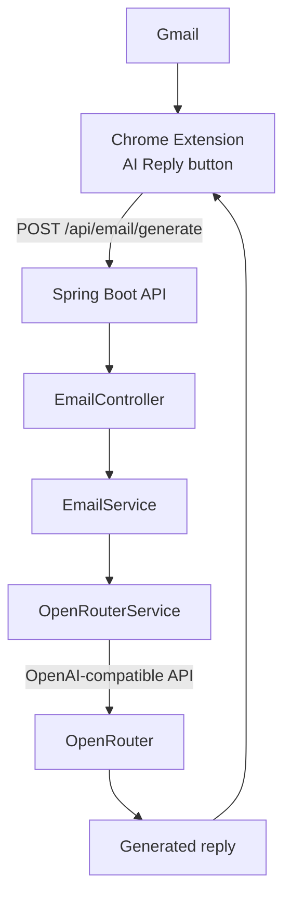

# AI Email Assistant

Generate Gmail replies in one click. A Chrome extension sends the email you're reading, plus a tone or custom instruction, to a Spring Boot backend, which asks OpenRouter to write the reply.

> **Status:** The backend is working and tested. The Chrome extension is the next milestone and is not built yet. See the [Roadmap](#roadmap).

---

## Why this project exists

Replying to email is repetitive. Most replies follow a pattern ("confirm the meeting," "politely decline," "ask for more details"), but writing each one still takes time. This project puts an AI assistant inside Gmail so the user can describe the reply they want and get a draft instantly.

## Demo

**Email received**

> Hi, can we schedule a meeting for tomorrow?

**Instruction**

> Write a professional reply.

**Generated reply**

> Hi, tomorrow works for me. Please let me know what time works best for you.

---

## How it works



1. The user opens an email in Gmail and clicks **AI Reply**.
2. The extension sends the email text and the user's instruction to the backend.
3. The backend validates the request and builds a prompt.
4. OpenRouter generates the reply and the backend returns it.
5. The extension inserts the reply into Gmail's compose box.

Steps 1, 2, and 5 are planned. Steps 3 and 4 are implemented today.

---

## Tech stack

| Layer | Technology |
|---|---|
| Backend | Java 21, Spring Boot, Spring Web, Bean Validation, Maven |
| AI | OpenRouter (OpenAI-compatible Chat Completions API) |
| Model | `nvidia/nemotron-3.5-super-vl:free` |
| Frontend (planned) | Chrome Extension, JavaScript, HTML, CSS |
| Tooling | Git, GitHub |

> **Migration note:** The project originally used Qwen through Alibaba DashScope. It now uses OpenRouter, which allows switching between models without changing the rest of the app.

---

## Getting started

**1. Get an API key** from [OpenRouter](https://openrouter.ai).

**2. Set the key as an environment variable** (never hardcode it in source):

```bash
# macOS / Linux
export OPENROUTER_API_KEY=your_key_here

# Windows (PowerShell)
$env:OPENROUTER_API_KEY="your_key_here"
```

`.env` files are listed in `.gitignore`, so local secrets are not committed.

**3. Run the backend:**

```bash
./mvnw spring-boot:run
```

---

## API reference

### `POST /api/email/generate`

**Request**

```json
{
  "emailContent": "Hi, can we meet tomorrow?",
  "instruction": "Write a professional reply."
}
```

| Field | Type | Required | Description |
|---|---|---|---|
| `emailContent` | string | yes | The email being replied to |
| `instruction` | string | yes | Tone or custom instruction for the reply |

Requests missing required fields are rejected by Bean Validation.

**Response:** the AI-generated reply text.

---

## Project structure

```text
src/main/java/com/inimai/ai_email_assistant
├── controller
│   └── EmailController.java      # REST endpoint
├── service
│   ├── EmailService.java         # Business logic and prompt building
│   └── OpenRouterService.java    # OpenRouter API client
├── dtos
│   └── EmailGenerateRequest.java # Validated request body
└── AiEmailAssistantApplication.java
```

The code is split into three layers: the **controller** handles HTTP, the **service** holds the logic, and the **AI client** is isolated in its own class, so the model provider can be swapped without touching the rest of the app.

---

## Author

**Inimai S**, [GitHub](https://github.com/inimai09)
