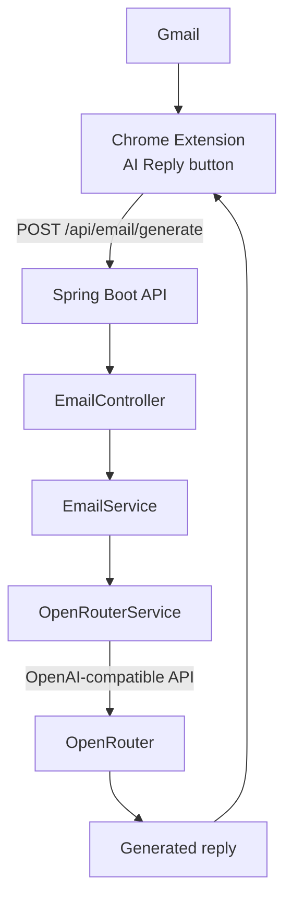

# AI Email Assistant

Generate Gmail replies in one click. A Chrome extension sends the email you're reading, along with a tone or custom instruction, to a Spring Boot backend, which asks OpenRouter to generate a reply.

> **Status:** Backend and Chrome extension (Manifest V3) are implemented. Load the unpacked extension from `chrome-extension/` and keep the backend running on `localhost:8080`. Gmail DOM behavior still needs manual verification.

## Why this project exists

Replying to email is repetitive. Most replies follow a pattern ("confirm the meeting," "politely decline," "ask for more details"), but writing each one still takes time.

This project puts an AI assistant inside Gmail so users can describe the reply they want and get a draft instantly.

## Demo

**Email received**

> Hi, can we schedule a meeting for tomorrow?

**Instruction**

> Write a professional reply.

**Generated reply**

> Hi, tomorrow works for me. Please let me know what time works best for you.

## How it works



1. The user opens an email in Gmail and clicks **AI Reply**.
2. The extension sends the email text and the user's instruction to the backend.
3. The backend validates the request and builds a prompt.
4. OpenRouter generates the reply and the backend returns it.
5. The extension inserts the reply into Gmail's compose box.

The above workflow is implemented in code. Gmail DOM behavior should be verified manually (see `chrome-extension/README.md`).

## Tech stack

| Layer    | Technology                                               |
| -------- | -------------------------------------------------------- |
| Backend  | Java 21, Spring Boot, Spring Web, Bean Validation, Maven |
| AI       | OpenRouter (OpenAI-compatible Chat Completions API)      |
| Model    | `nvidia/nemotron-3.5-super-vl:free`                      |
| Frontend | Chrome Extension (Manifest V3), JavaScript, HTML, CSS    |
| Tooling  | Git, GitHub                                              |

> **Migration note:** The project originally used Qwen through Alibaba DashScope. It now uses OpenRouter, which allows switching between models without changing the rest of the application.

## Getting started

### 1. Get an API key

Create an API key from [OpenRouter](https://openrouter.ai).

### 2. Set the API key as an environment variable

Never hardcode API keys in source code.

**Windows (PowerShell)**

```powershell
$env:OPENROUTER_API_KEY="your_key_here"
```

**macOS / Linux**

```bash
export OPENROUTER_API_KEY=your_key_here
```

`.env` files are listed in `.gitignore`, so local secrets are not committed.

### 3. Run the backend

**Windows (PowerShell)**

```powershell
.\mvnw spring-boot:run
```

**macOS / Linux**

```bash
./mvnw spring-boot:run
```

The backend runs on `localhost:8080`.

### 4. Load the Chrome extension

1. Open Chrome or Microsoft Edge.
2. Navigate to `chrome://extensions` or `edge://extensions`.
3. Enable **Developer mode**.
4. Click **Load unpacked**.
5. Select the project's `chrome-extension/` folder.
6. Open Gmail and test the extension.

Keep the backend running while using the extension.

## API reference

### `POST /api/email/generate`

**Request**

```json
{
  "emailContent": "Hi, can we meet tomorrow?",
  "instruction": "Write a professional reply."
}
```

| Field          | Type   | Required | Description                              |
| -------------- | ------ | -------- | ---------------------------------------- |
| `emailContent` | string | Yes      | The email being replied to               |
| `instruction`  | string | Yes      | Tone or custom instruction for the reply |

Requests missing required fields are rejected by Bean Validation.

**Response:** The AI-generated reply text.

## Project structure

```text
src/main/java/com/inimai/ai_email_assistant
├── controller
│   └── EmailController.java
├── service
│   ├── EmailService.java
│   └── OpenRouterService.java
├── dtos
│   └── EmailGenerateRequest.java
└── AiEmailAssistantApplication.java

chrome-extension/
├── manifest.json
├── background.js
├── content.js
├── selection-utils.js
├── sentence-assistant.js
├── content.css
└── README.md
```

### Backend responsibilities

* **EmailController:** Handles the REST API endpoint.
* **EmailService:** Handles business logic and prompt building.
* **OpenRouterService:** Communicates with the OpenRouter API.
* **EmailGenerateRequest:** Represents and validates the incoming request.

### Extension responsibilities

* **manifest.json:** Defines the Manifest V3 extension configuration.
* **background.js:** Communicates with the local backend.
* **content.js:** Handles Gmail integration and the AI Reply panel.
* **selection-utils.js:** Handles text selection and replacement.
* **sentence-assistant.js:** Provides sentence-level editing functionality.
* **content.css:** Defines the extension's styling.

The code is split into separate layers so that the AI provider can be changed without rewriting the controller or business logic.

## Roadmap

### Backend

* [x] Spring Boot project setup
* [x] `POST /api/email/generate` endpoint
* [x] Request DTO with validation
* [x] Service layer and OpenRouter integration
* [x] Environment-based API key configuration (`OPENROUTER_API_KEY`)
* [x] End-to-end request flow tested
* [ ] Improved error handling and retry strategy
* [ ] Rate limiting
* [ ] Logging and monitoring

### AI

* [x] OpenRouter API integration
* [ ] Improved prompt design
* [ ] Preset tones (professional, friendly, short, firm)
* [ ] Context-aware replies for long email threads

### Chrome extension

* [x] Gmail integration code
* [x] AI Reply button implementation
* [x] Tone picker and custom instruction input
* [x] Backend integration
* [x] Reply insertion implementation
* [x] Loading and error states
* [x] Edit the reply before inserting
* [x] Sentence-level editing functionality
* [ ] Complete manual verification in Gmail
* [ ] Publish the extension

### Deployment

* [ ] Deploy the backend
* [ ] Publish the extension

## Author

**Inimai S** — [GitHub](https://github.com/inimai09)
