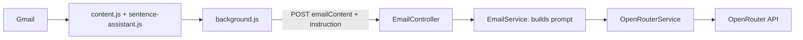

# AI Email Assistant

A Chrome extension (Manifest V3) and Spring Boot backend that help you write Gmail replies with AI. Pick a tone or write your own instruction, edit the draft, and insert it into Gmail. **It never sends emails. You stay in control.**

> **Status: actively developed.** The backend is implemented and tested at the API level. The extension is implemented in code but **not yet verified end to end in live Gmail**. The AI Reply button needs debugging because Gmail's DOM may differ from the selectors used. Nothing is deployed or published.

## Why

Using ChatGPT for email means copying the email out, explaining the context, copying the reply back, and re-prompting to fix one sentence. This project moves that workflow into Gmail and lets you edit just the part you want.

## How It Works



1. Open an email in Gmail and click **AI Reply**.
2. Choose Professional, Friendly, Concise, or a custom instruction.
3. The extension sends the email and instruction to the backend at `localhost:8080`.
4. The backend builds a prompt, calls OpenRouter, and returns the reply as text.
5. Edit the reply, then insert it into Gmail's composer.

**Why layers?** The controller handles HTTP, the service owns prompt building, and `OpenRouterService` isolates the AI provider. The project already migrated from DashScope/Qwen to OpenRouter, so that swap stayed contained.

## Sentence-Level Editing

Select text in the generated reply or Gmail composer and a floating toolbar offers: edit manually, improve with AI, make concise, make professional, or apply a custom instruction. AI edits go to the same backend endpoint, and the result is previewed before it replaces only your selection. *Implemented in code, not yet verified in live Gmail.*

## Tech Stack

| Layer | Technology |
|---|---|
| Backend | Java 21, Spring Boot 4.1.1, Spring Web, Bean Validation, Maven |
| AI | OpenRouter (OpenAI-compatible Chat Completions), model `nvidia/nemotron-3.5-super-vl:free` |
| Extension | Manifest V3, JavaScript, HTML, CSS |

PostgreSQL was used in an earlier authentication implementation and is not documented as required for email generation.

## Key Files

| File / Class | Role |
|---|---|
| `EmailController` | REST endpoint |
| `EmailService` | Prompt building and business logic |
| `OpenRouterService` | OpenRouter API client |
| `EmailGenerateRequest` | Request DTO with validation |
| `manifest.json` | MV3 config, targets `https://mail.google.com/*` |
| `background.js` | Calls the backend at `localhost:8080` |
| `content.js` | Gmail integration, AI Reply button, panel, insertion |
| `selection-utils.js` | Selection and replacement for textarea and contenteditable |
| `sentence-assistant.js` | Floating sentence toolbar |
| `content.css` | Extension styling |

## Setup

**Prerequisites:** Java 21, Maven, an [OpenRouter](https://openrouter.ai) API key, Chrome or Edge.

**1. Set the API key.** Never hardcode it or commit it.

```powershell
# Windows PowerShell
$env:OPENROUTER_API_KEY = "your-key"
```
```bash
# macOS / Linux
export OPENROUTER_API_KEY="your-key"
```

**2. Run the backend** from the folder containing `pom.xml`:

```bash
mvn spring-boot:run
```

**3. Load the extension.** Open `chrome://extensions` (or `edge://extensions`), enable Developer mode, click **Load unpacked**, and select the folder with `manifest.json`. Then open Gmail and an email.

## API

### `POST /api/email/generate`

| Field | Type | Required |
|---|---|---|
| `emailContent` | string | Yes |
| `instruction` | string | Yes |

```bash
curl -X POST http://localhost:8080/api/email/generate \
  -H "Content-Type: application/json" \
  -d '{"emailContent": "Hi, can we schedule a meeting for tomorrow?", "instruction": "Write a professional reply."}'
```

**Response:** the generated reply as text. The backend handles AI API failures, missing configuration, and validation errors. Exact status codes and error bodies are not documented yet.

** DEMO **


## Author

Inimai S
